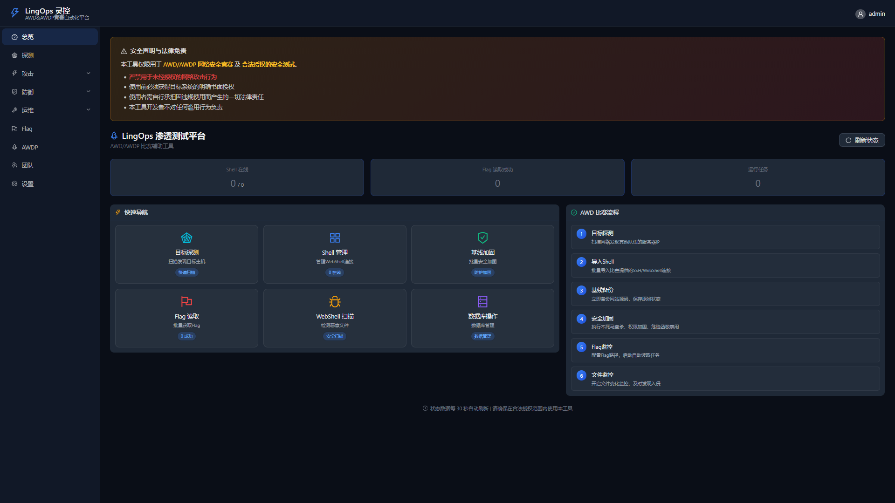
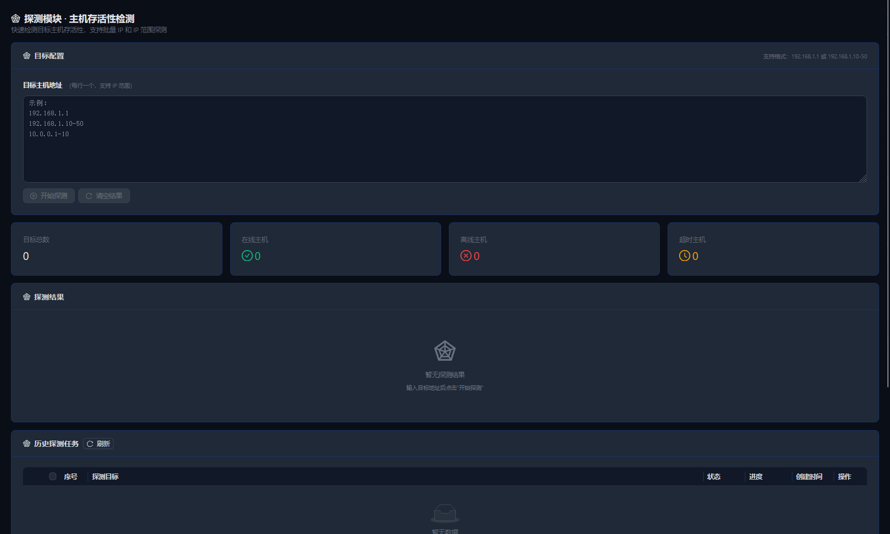
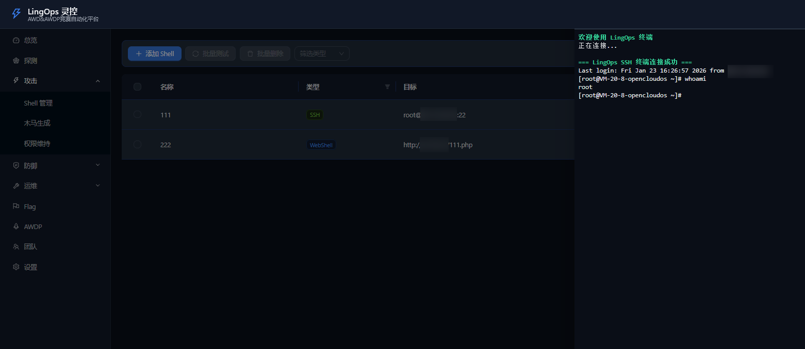
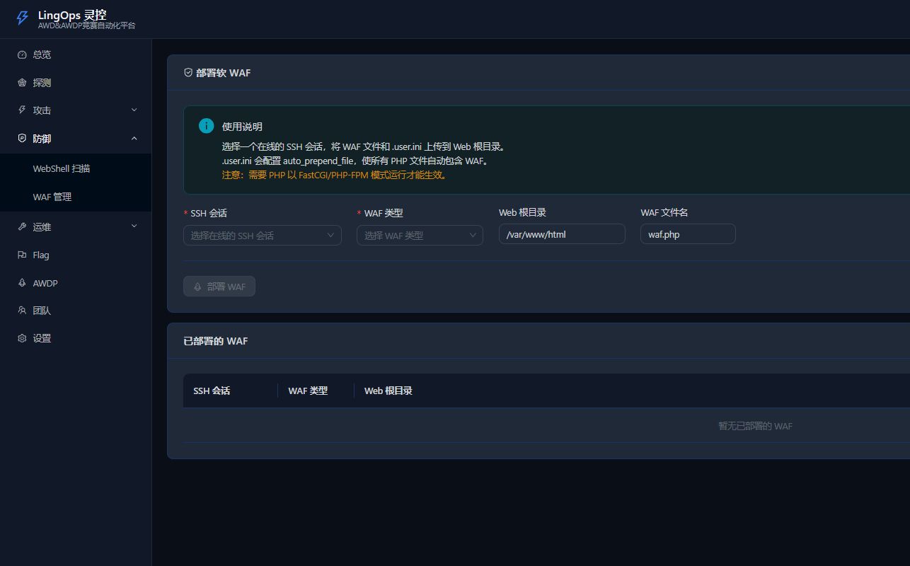
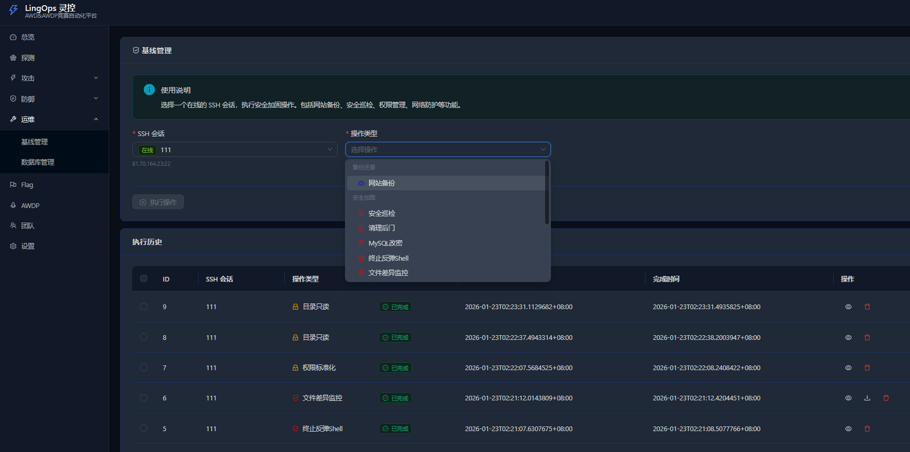
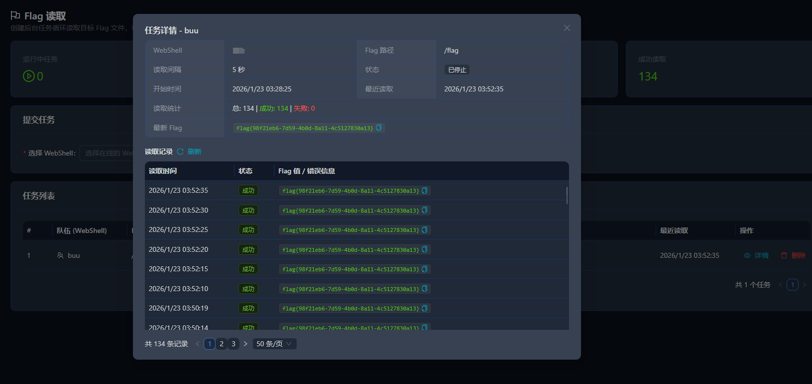
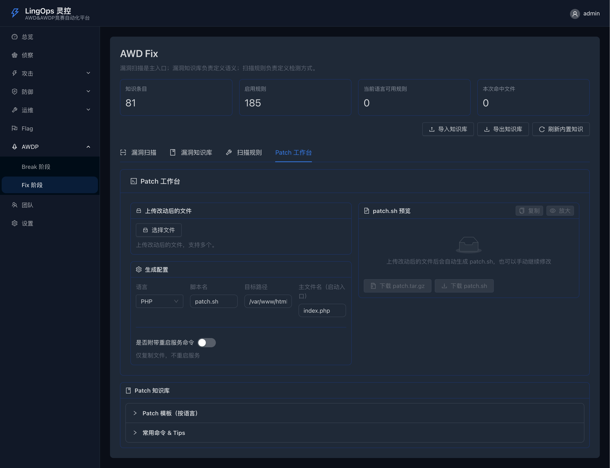

# LingOps（灵控）- AWD/AWDP 竞赛自动化平台

<p align="center">
  
  
  
  
</p>

## 📖 简介

LingOps（灵控） 是一个专为 AWD/AWDP 攻防竞赛设计的竞赛自动化平台，提供 IP探测、WebShell 管理、SSH 终端、基线加固、Flag 读取等核心功能，帮助参赛选手在比赛中高效管理多个目标。


## ✨ 核心功能

### 🔍 目标探测
- **网络扫描** - 快速检测目标主机存活性，支持批量 IP 和 IP 范围探测

### ⚡ 攻击模块
- **Shell 管理** - WebShell/SSH 连接管理，支持虚拟终端、文件管理
- **木马生成** - 生成各种类型的 WebShell 木马
- **权限维持** - 通过不死马、内存马维持已获取的权限

### 🛡️ 防御模块
- **WebShell 扫描** - 基于规则引擎的 WebShell 检测，支持 ZIP 上传和远程扫描
- **WAF 管理** - WAF 规则配置与部署

### 🛠️ 运维模块
- **基线管理** - 网站备份、安全巡检、权限标准化、PHP 安全配置、后门清理、文件差异监控、反弹 Shell 终止、端口封禁、SSH密码修改、Mysql密码修改
- **数据库管理** - MySQL 连接管理、SQL 执行、数据库备份恢复

### 🚩 Flag 读取
- **后台任务模式** - 切换页面不中断

- **定时读取** - 设置间隔自动循环读取

- **历史记录** - 查看所有读取记录和时间

### ⚡ AWDP 专项
- **Break阶段** -  1.漏洞发现 2.Payload 构造 3.漏洞利用 4.WAF 绕过

- **Fix阶段** -  1.漏洞扫描 2.漏洞知识库 3. 扫描规则 4.Patch 工作台

### ⏳ Flag 自动提交（待开发）
> 自动化提交 Flag 的系统，用于竞赛或演练场景。

### ⏳ 其他功能（待开发）
> 其他辅助工具或扩展功能，具体内容待定。


## 🚀 快速开始


### 1. 发行版本下载
我们提供预编译的二进制包，您可以从 [GitHub Releases](https://github.com/zhanglinglingc/lingops/releases) 页面下载最新版本。

**当前最新版本：v0.2.0**

| 操作系统 | 版本 | 下载 | 描述 |
| :--- | :--- | :--- | :--- |
| **Windows** | v0.2.0 | [LingOps_v0.2.0_win64.zip](https://github.com/zhanglinglingc/lingops/releases/download/v0.2.0/LingOps_v0.2_win64.zip) | 64位Windows可执行程序 |
| **Linux** | v0.2.0 | [LingOps_v0.2.0_linux_amd64.zip](https://github.com/zhanglinglingc/lingops/releases/download/v0.2.0/LingOps_v0.2_linux_amd64.zip) | 64位Linux可执行程序 |
| **macOS** | v0.2.0 | [LingOps_v0.2.0_darwin_arm64.zip](https://github.com/zhanglinglingc/lingops/releases/download/v0.2.0/LingOps_v0.2_darwin_arm64.zip) | Apple Silicon (ARM64)  版本 |

> **注意**：如果您需要更早的版本或查看更新日志，请访问完整的 [Releases 页面](https://github.com/zhanglinglingc/lingops/releases)。

### 2. 启动可执行文件

> ⚠️ 必须在**解压后的目录内**启动。程序按「当前工作目录」查找 `configs/config.yaml`，在其它目录（例如用户主目录）直接运行二进制会报 `Failed to load config: failed to read config: Config File "config" Not Found in ...`。

**macOS / Linux**

```bash
unzip LingOps_v0.2_darwin_arm64.zip     # 按实际下载的包名替换
cd LingOps_v0.2_darwin_arm64
chmod +x lingops-server
./start.sh
```

`start.sh` 会先 `cd` 到脚本所在目录再启动 `lingops-server`，因此在哪个目录执行都不会出现配置文件找不到的问题。

macOS 上从网络下载的包首次运行会被 Gatekeeper 拦截，先去掉隔离属性：

```bash
xattr -cr LingOps_v0.2_darwin_arm64
```

**Windows**

解压后进入 `LingOps_v0.2_win64` 目录，双击 `start.bat`（或在 cmd 里执行 `start.bat`）。

**修改端口 / 数据库**

服务默认监听 `12800`，配置都在 `configs/config.yaml`：

```yaml
server:
  port: 12800
database:
  type: "sqlite"
  name: "data/lingops.db"
```

> 服务默认监听 `*:12800`（所有网卡，不只是 `127.0.0.1`），同网段可直接访问。比赛/公网环境请用防火墙限制来源 IP。

### 3. 访问
打开浏览器访问 `http://127.0.0.1:12800`（端口以 `configs/config.yaml` 的 `server.port` 为准，不是 8080）

**默认账号密码：**
- 用户名：`admin`

- 密码：`admin123`

  

## ❓ 常见问题

| 现象 | 原因 | 处理 |
| :--- | :--- | :--- |
| `Failed to load config: failed to read config: Config File "config" Not Found in "[/Users/xxx/configs /Users/xxx /etc/lingops]"` | 没有在解压目录内启动。程序先找当前工作目录下的 `configs/config.yaml`，找不到才回退到 `~/configs`、`~`、`/etc/lingops` | `cd` 进解压目录后再启动，或直接用 `./start.sh` / `start.bat`（它们会自动切到脚本所在目录） |
| macOS 提示「Apple 无法检查其是否包含恶意软件」 | 二进制未签名，被 Gatekeeper 隔离 | `xattr -cr <解压目录>`，或「系统设置 → 隐私与安全性 → 仍要打开」 |
| 页面打不开 / 接口全部失败 | 访问的不是服务端口（默认 `12800`） | 访问 `http://127.0.0.1:12800`，端口以 `configs/config.yaml` 的 `server.port` 为准 |
| 启动报 `address already in use` | 端口被占用 | 改 `configs/config.yaml` 的 `server.port`，或结束占用该端口的进程 |
| 想清空数据重新开始 | 业务数据存在 SQLite | 停服务后删除 `data/lingops.db`，重启会自动重建空库 |

## 🔒 部分功能预览

### ✨ 首页



### 🔍 目标探测



### ⚡ shell管理



### 🛡️ WAF管理



### 🛠️ 基线管理



### 🚩 Flag 读取



### ⚡ AWDP专项



## 🔒 安全说明

⚠️ **本工具仅供授权的安全测试和 CTF 比赛使用！**

- 请勿用于未授权的系统
- 请勿用于非法活动
- 使用者需自行承担法律责任


